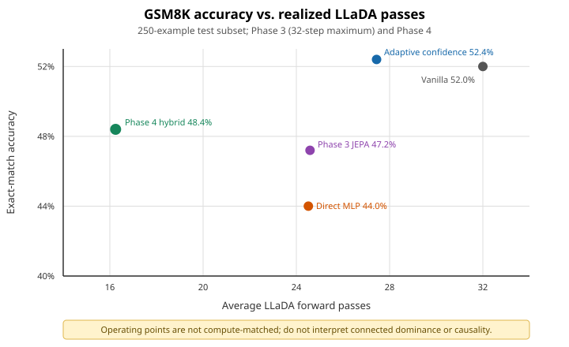

# JEPA-Guided Parallel Unmasking: An Empirical Investigation

> **Research status: Completed / Archived.** This exploratory project did not establish that JEPA-guided unmasking outperforms confidence-based decoding. The research direction has been discontinued; the repository is retained as a reproducible negative-result archive.

## Motivation and hypothesis

Diffusion language models generate by iteratively replacing masked tokens. A confidence-based decoder commits the highest-confidence proposals, but local confidence may not capture how a commitment changes the representation or the eventual answer. This project tested whether a Joint-Embedding Predictive Architecture (JEPA) controller could predict the downstream representation after a candidate unmasking action and use that prediction to select better parallel commitments.

The hypothesis was that representation-aware action scoring would improve the accuracy/compute frontier over both standard confidence decoding and a direct MLP trained on the same action features. On the recorded GSM8K experiments, that hypothesis was not supported.

## Method overview

LLaDA-8B-Instruct remains frozen throughout. At each decoding state, one LLaDA pass supplies token proposals, confidence scores, margins, and—when needed—hidden states. Candidate actions commit groups of proposed tokens. The controller consists of:

1. deterministic random projections of current-state, masked-position, selected-position, and proposed-token representations;
2. an action-conditioned predictor trained to predict three projected post-action representations; and
3. a scalar head that scores a candidate from the action features and predicted representations.

A direct-MLP control predicts the same scalar target without the predicted future representation. Early phases consider only confidence-ranked prefixes; Phase 3 adds a small capped set of non-prefix candidates. No phase modifies or fine-tunes LLaDA itself. See [the experiment record](docs/experiments.md) for the target used in each phase.

## Experimental setup

- **Backbone:** LLaDA-8B-Instruct, loaded from a local snapshot with remote model code enabled and model parameters frozen.
- **Task:** GSM8K exact-match accuracy after numeric answer extraction.
- **Data selection:** seed 17; 800 training and 100 validation examples selected from a seeded shuffle of GSM8K train, plus 250 examples from a shuffle of the official test split with seed 18.
- **Generation:** 128 response tokens, one 128-token block, deterministic temperature 0, and maximum step budgets of 16/32 (Phases 1–2) or 16/24/32 (Phase 3).
- **Representation projection:** 256 dimensions with projection seed 314159.
- **Comparators:** scheduled vanilla confidence decoding, thresholded adaptive-confidence decoding, JEPA-guided decoding, and a direct MLP.

Step budgets are maxima: adaptive policies may finish early. Accuracy at the same configured budget is therefore not necessarily accuracy at matched realized compute.

## Main findings

The final Phase 3 32-step comparison on the same 250-example test subset was:

| Method | Accuracy | Avg. LLaDA passes |
|---|---:|---:|
| Adaptive confidence | **52.4%** | 27.440 |
| JEPA | 47.2% | 24.588 |
| Direct MLP | 44.0% | 24.516 |
| Vanilla | 52.0% | 32.000 |

Phase 3.1's best tested JEPA ablation was the **pre-ranking, prefix-only** controller at 48.0% accuracy and 22.692 average passes. Phase 4's selective hybrid reached 48.4% at 16.248 average LLaDA passes, compared with the saved adaptive baseline's 52.4% at 27.44 passes; it rescued 15 baseline errors but lost 25 baseline successes.

These results show a realized-pass reduction for the Phase 4 hybrid, not overall superiority. There was no compute-matched baseline at approximately 16.248 passes, so the speed/accuracy point cannot isolate the value of JEPA guidance. The 250-example test subset had also been inspected in earlier phases, making later comparisons exploratory rather than confirmatory.



Across phases, representation prediction and proxy/ranking diagnostics could look strong without translating into better online GSM8K accuracy. The strongest confidence baseline remained more accurate than every tested JEPA policy in the final comparisons. Full tables, phase changes, paired outcomes, and limitations are in [docs/experiments.md](docs/experiments.md); machine-readable summaries are in [research_artifacts](research_artifacts/README.md).

## Repository structure

```text
configs/                 Historical phase configurations (portable paths)
docs/                    Experiment record, audit, and reproduction guide
pbs/                     Preserved PBS/HPCC job scripts
research_artifacts/      Small verified result summaries and audits
scripts/                 Dependency-aware PBS submission helpers
src/jepa_pu/             Data, decoding, training, evaluation, and ablations
tests/                   Lightweight CPU-only checks
```

`src/jepa_pu/decode.py.before_phase31` is intentionally retained as a historical pre-Phase-3.1 implementation snapshot. Generated datasets, trajectories, checkpoints, model weights, prediction-level outputs, caches, and raw scheduler logs are not published.

## Installation

Python 3.10 or newer is required. For a fresh environment:

```bash
python -m venv .venv
source .venv/bin/activate
python -m pip install --upgrade pip
python -m pip install -e .
```

The historical environment used the dependency constraints in `pyproject.toml`/`requirements.txt`; an exact lockfile and CUDA/driver manifest were not retained. LLaDA model weights are not included. Because loading uses `trust_remote_code: true`, review the model repository code and pin a trusted local snapshot.

## Reproduction

Set portable paths before invoking a phase:

```bash
export JEPA_MODEL_PATH=/path/to/LLaDA-8B-Instruct/snapshot
export JEPA_ARTIFACT_ROOT=/path/to/writable/jepa-artifacts
```

Prepare the deterministic split and run the Phase 1 pipeline commands:

```bash
python -m jepa_pu.data --config configs/phase1.yaml
python -m jepa_pu.trajectories --config configs/phase1.yaml --split train
python -m jepa_pu.trajectories --config configs/phase1.yaml --split validation
python -m jepa_pu.train --config configs/phase1.yaml
python -m jepa_pu.evaluate --config configs/phase1.yaml
```

These are GPU/model workloads; do not run them merely to validate the archive. PBS entry points and exact phase sequences are documented in [docs/reproducibility.md](docs/reproducibility.md). Lightweight checks require no model weights:

```bash
python -m compileall -q src tests
python -m unittest discover -s tests -v
bash -n scripts/*.sh pbs/*.pbs
```

## Scope and limitations

- Results cover one model, one benchmark, one prompt format, one 250-example test subset, and small candidate-action spaces.
- Phase 3 rollout targets use one deterministic off-policy continuation per action, not an expected downstream reward.
- Phase 4 chooses its gate on only 36 held-out validation questions.
- Later work repeatedly analyzed the same test subset; uncertainty estimates and repeated-seed studies were not recorded.
- Model weights, checkpoints, raw trajectories, prepared dataset rows, prediction-level outputs, and the exact software/hardware lockfile are absent from this public archive.

The code and compact outputs are published to document what was tried, what failed to outperform the baseline, and which artifacts would be needed for replication—not as a claim of a state-of-the-art method.

## Citation and license

No citation metadata or license has been assigned. Add a license only after confirming the intended reuse terms and verify upstream LLaDA/GSM8K terms before publication.
